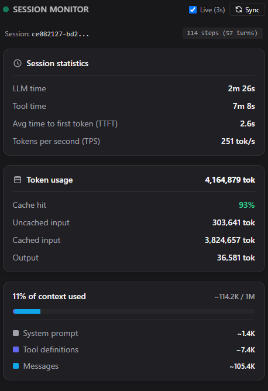

# Antigravity Session Statistics



A real-time telemetry sidecar extension for Google Antigravity 2.0 that visualizes live LLM response and tool latency, token consumption, cache hit efficiency, and context window headroom directly in your Auxiliary Side Pane.

---

## Installation

You can install this plugin directly from within Antigravity by asking the agent in the chatbox:

> **"Install the session-stats plugin from `https://github.com/<your-username>/<your-repo>`"**

The Antigravity agent will clone and install the plugin into your local customizations folder (`~/.gemini/config/plugins/session-stats/`). No manual terminal commands, build steps, or external dependencies are required.

---

## How to Use

Once installed, you can open the live telemetry dashboard in any chat session by:

1. **Clicking the Navigation Pill**:
   ```markdown
   [📊 Session Statistics](sidecar://session-stats/viewer/ui.html)
   ```
2. **Asking the Agent**:
   Simply ask the agent in chat:
   > *"Show session statistics"* or *"How many tokens have I used in this session?"*

The sidecar panel renders immediately in your **Auxiliary (Side) Pane** and auto-syncs live every 3 seconds as you chat.

---

## Requirements

- **Antigravity 2.0**
- **Node.js** (v18+)

---

## License

[MIT](LICENSE)
